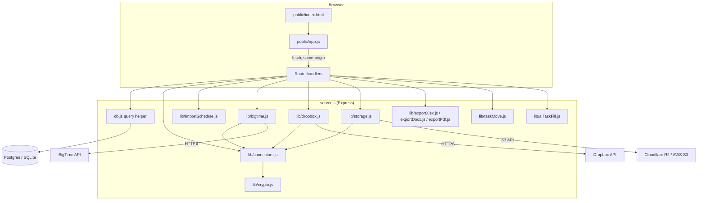
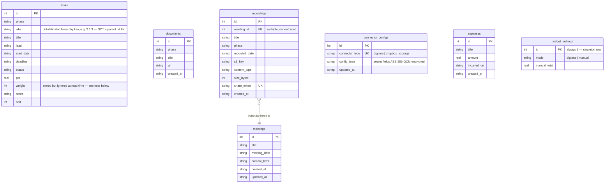

# Architecture

This document is written for whoever picks this codebase up next — most likely an AI agent tasked with porting it into the org's systems-engineering (SE) tool, which already has multi-tenancy, real user accounts, and roles. It describes what this app actually is today, after the portability-upgrade work on `feature/portability-upgrade`, plus a carried-forward design for the multi-tenant conversion this app was originally going to get before that plan changed in favor of folding it into the SE tool instead.

## What this app is

A single-tenant project-schedule/budget/meetings/recordings dashboard. Node/Express backend, a vanilla JS frontend (no framework, no build step — `public/*.js` is served as-is), Postgres in production (Railway) or SQLite locally, switched automatically by whether `DATABASE_URL` is set.

There is exactly one "project" per deployment. Everything — tasks, meetings, documents, recordings, budget — belongs to that one implicit project. Access is a single shared site password (`APP_PASSWORD`, HTTP Basic Auth, any username accepted) plus a separate password just for editing connector credentials (`CONNECTOR_ADMIN_PASSWORD`). **There is no concept of individual users, sessions, or roles anywhere in this codebase.** That's the biggest single gap to close when porting into a real multi-tenant host — see "Carried-forward multi-tenant design" below.

## Component overview

`server.js` is one large file (~1240 lines) with every route defined inline — there's no router-splitting by feature. That's a deliberate simplicity choice for a single-tenant app this size; a multi-tenant port will likely want to split it (see below).

## Data model

**The task hierarchy is string-prefix matching, not foreign keys.** A row's WBS (e.g. `"2.1.3"`) determines its place in the tree: it's a "leaf" iff no other row's WBS starts with `"2.1.3."`. Parent rows have their `start_date`/`deadline`/`pct`/`status` recomputed from their leaf descendants on **every read** (`computedTasks()` in `server.js`) — nothing is cached or materialized. `weight` is similarly recomputed from `start_date`/`deadline` at read time (`computeWeight()`), not read from the stored column — the stored `weight` column is a historical leftover, effectively dead. **This is the single easiest thing for a porting effort to get wrong**: two projects with overlapping WBS numbers in a naively-added `project_id` column would corrupt each other's rollups unless every query behind `computedTasks()` is filtered by `project_id` — there is no structural guard against this today because there's only ever been one project.

## Frontend architecture

No framework, no bundler, no build step — `public/index.html`, `public/app.js` (~1600 lines), and `public/styles.css` are served as-is by `express.static`. A future port will almost certainly want to rebuild the UI in the target tool's own component system rather than reuse these files directly; what matters for that rebuild is the *behavior* they encode, not the markup.

- **Tabs are pure convention, not a router.** A `<button class="tab" data-view="X">` plus a `<section id="view-X" class="view">` is the entire contract — `activateTab(view)` toggles `.active` on both by matching `"view-" + view` to the section id. Adding/removing a tab needs no registry update. There's a small amount of real client-side routing layered on top (`routeFromLocation()` / `popstate`) that maps `/meetings/:id` to opening a specific meeting directly, for shareable links.
- **One fetch wrapper, `api(path, opts)`**, used by every call. It merges headers explicitly (a past bug let a caller's own `headers` option silently clobber `Content-Type` instead of merging with it — fixed, but worth knowing the failure mode if a port reintroduces something similar) and throws on any non-2xx response with the server's `error` message.
- **The "check `/status`, toggle `hidden`" idiom** is used for every optional feature (BigTime gauge, recordings storage, Dropbox chooser, connector cards) — call `GET /api/<feature>/status`, branch on `.configured`. This is the pattern a port should replicate for "is this integration set up" checks generally.
- **The meeting notes editor** is a `contenteditable` div, not a rich-text library. "Meeting mode" (`meetingModeOn` in `public/app.js`) forces newly-typed text to a fixed color via `document.execCommand('foreColor', ...)` and an input-event handler that recolors text as it's typed, regardless of how it's entered (typing, Enter for a new bullet, Tab to indent) — this is bespoke, somewhat fragile-by-nature (built on `execCommand`, which is a deprecated browser API still widely supported but not guaranteed forever) code that a port should probably replace with a real rich-text editor component rather than preserve as-is.
- **Drag-and-drop task reordering** is a pure function, `computeMove()` in `lib/taskMove.js` — given the full flat task list and a `(draggedId, targetId, position)` triple, it returns just the rows whose `wbs`/`sort`/`phase` actually changed. It fully recomputes WBS numbering for the affected subtree rather than incrementally patching it, which the file's own header comment notes is a deliberate simplicity choice at this data size. This function is reusable as-is if the port keeps the WBS-string model; it needs no frontend-specific logic.
- **Toasts, not modals**, for feedback (`toast(message)`, a single transient banner) — there is no alert/confirm UI beyond the browser's native `confirm()` for destructive actions (delete a task, replace the schedule via import).

## Key user flows, end to end

A few representative flows, traced through the real code, since the schema and route list alone don't convey how the pieces actually compose:

**Editing a task's % complete (inline edit on the Schedule or Dashboard tab):** frontend builds a small inline `<input>`/`<select>` form directly in the table row → `PATCH /api/tasks/:id` → server enforces the Complete⇔100% rule, writes the row → `syncFutureMeetingSnapshots()` regex-replaces the "upcoming two weeks" `<table>` inside every future-dated meeting's saved `content_html` (past meetings are frozen and never touched) → frontend calls `refreshAll()`, which re-fetches dashboard, schedule, and meetings list. One write, three UI surfaces updated, because they're all reading the same `computedTasks()` rollup rather than maintaining separate derived state.

**Dragging a task to reparent it:** frontend sends `(draggedId, targetId, position)` to `POST /api/tasks/:id/move` → `computeMove()` (pure function, no DB access) computes the new `wbs`/`sort`/`phase` for every affected row → server writes just those changed rows → same `syncFutureMeetingSnapshots()` + rollup-on-read cascade as above.

**Uploading a recording:** frontend requests a presigned PUT URL (`POST /api/recordings/upload-url`, server never sees the file) → browser uploads the file bytes directly to the bucket → frontend calls `POST /api/recordings` with the resulting key to save metadata and mint a `share_token` → the permanent link (`GET /r/:token`) looks up the recording by token and 302-redirects to a freshly presigned, short-lived GET URL on every visit, so the link itself never expires even though each underlying signed URL does.

**Connector credential resolution on every outbound call** (e.g. a BigTime budget fetch): `lib/bigtime.js` calls `connectors.getConfig('bigtime')` → `lib/connectors.js` checks `connector_configs` for a stored row, decrypts any secret fields present, and for any field still missing falls back to the legacy env var → the resolved `{apiKey, firmId, projectName}` is used for that one call and not cached (a fresh `S3Client` is similarly built per-call in `lib/storage.js`, since config can now change at runtime via the Connectors UI — a cached client with stale credentials would silently keep using them until a restart).

## Connector abstraction (the pattern to extend for multi-tenancy)

`lib/connectors.js` resolves BigTime/Dropbox/storage config from `connector_configs` first, falling back to legacy Railway env vars field-by-field. Secrets (`apiKey`, `appSecret`, `refreshToken`, `accessKeyId`, `secretAccessKey`) are AES-256-GCM encrypted via `lib/crypto.js`, using a single master key (`CREDENTIAL_ENCRYPTION_KEY`) — the only connector-related secret still in an env var. `lib/bigtime.js`, `lib/dropbox.js`, and `lib/storage.js` all call `connectors.getConfig(type)` instead of reading `process.env` directly.

This is a single-tenant version of exactly the pattern a multi-tenant host needs: one row per `(project_id, connector_type)` instead of one row per `connector_type`, with the same encrypt-at-rest, resolve-at-call-time shape. The `setConfig`/`getStatus`/`getConfig` functions in `lib/connectors.js` would need a `projectId` parameter threaded through, and the `UNIQUE(connector_type)` constraint on `connector_configs` becomes `UNIQUE(project_id, connector_type)` — otherwise the design doesn't change.

Connector edits are gated by `CONNECTOR_ADMIN_PASSWORD` (a single shared password, checked via a custom header, not Basic Auth, to avoid stacking two native browser auth prompts) rather than any real role check — there's no role system to check against yet. **This must become a real permission check (project admin or system admin only) once RBAC exists** — see below.

## Full route inventory

| Route | Purpose |
|---|---|
| `GET /api/schedule` | Full computed task tree (rollups applied) |
| `GET /api/dashboard` | Stats, phase summary, near-term/overdue lists |
| `GET /api/lists` | Dropdown data (leads, top-level WBS, subtasks) |
| `GET /api/ai/status`, `POST /api/ai/parse-task` | AI-assisted task entry (Anthropic) |
| `POST /api/tasks`, `PATCH/DELETE /api/tasks/:id` | Task CRUD |
| `POST /api/tasks/:id/move`, `POST /api/tasks/insert` | Drag-reorder/reparent, "+" quick-add |
| `GET /api/export.csv`, `GET /api/export.xlsx` | Schedule export (doubles as the import template) |
| `POST /api/schedule/import` | Replace the whole schedule from an uploaded CSV/XLSX |
| `GET/POST /api/meetings`, `GET/PATCH/DELETE /api/meetings/:id` | Meeting agenda/notes CRUD |
| `GET /api/meetings/search` | Full-text-ish search across meeting notes |
| `GET /api/meetings/:id/export.docx`, `.../export.pdf`, `POST .../dropbox` | Meeting exports |
| `GET /api/connectors`, `POST /api/connectors/unlock`, `PUT /api/connectors/:type` | Connector settings (view unrestricted, edit admin-password-gated) |
| `GET /api/bigtime/status`, `GET /api/bigtime/budget` | BigTime-specific status/budget (legacy shape, now backed by `lib/connectors.js`) |
| `GET /api/budget`, `GET/PUT /api/budget/settings` | Unified budget data source (BigTime or manual, whichever mode is active) |
| `GET/POST /api/expenses`, `PATCH/DELETE /api/expenses/:id` | Manual expense log |
| `GET /api/dropbox/status`, `GET /api/dropbox/chooser-config` | Dropbox status + public app key for the Chooser widget |
| `GET/POST /api/documents`, `DELETE /api/documents/:id` | Key documents (Dropbox links) |
| `GET /api/storage/status` | Recording storage status |
| `GET/POST /api/recordings`, `PATCH/DELETE /api/recordings/:id`, `POST /api/recordings/upload-url` | Recording CRUD + presigned upload |
| `GET /r/:token` | Permanent recording share link → redirects to a fresh presigned URL |
| SPA fallback (`GET /^\/(?!api\/).*/ `) | Serves `index.html` for any non-API path (client-side tab/route state) |

## Carried-forward multi-tenant design

This was worked out in detail during an earlier planning pass, before the direction changed to port into the SE tool instead of building multi-tenancy here. It's preserved below so that work isn't lost.

**Schema additions:**
- `projects` (id, name, slug, created_at, created_by)
- `users` (id, email, password_hash, name, is_system_admin, created_at, disabled_at) — global identities, no tenancy
- `project_memberships` (project_id, user_id, role: `admin`|`member`, unique per pair) — `is_system_admin` bypasses this table entirely and gets access to everything
- `sessions` (id, user_id, expires_at) — hand-rolled, not `express-session`, specifically because the standard Postgres session store (`connect-pg-simple`) doesn't work with this codebase's SQLite dev mode; a DB-backed sessions table queried through the existing `query()` helper works identically in both
- `project_id` added to `tasks`, `documents`, `meetings`, `recordings`, and to `connector_configs`'s unique constraint

**Auth mechanism:** hand-rolled session cookie (`sessionId.hmac`, HMAC-verified before any DB lookup, DB row is the source of truth so logout = delete the row), password hashing via Node's built-in `crypto.scrypt` — zero new dependencies, consistent with this codebase's existing preference for hand-rolling simple things (it already hand-rolled Basic Auth instead of pulling in `passport`). **Note:** meeting Word/PDF export links are plain `<a href>` navigations, not `fetch()` calls — a bearer-token-in-header auth scheme can't authenticate a link click, which is one concrete reason the session has to be cookie-based, not header-based.

**Project context:** URL path (`/api/projects/:projectId/...`, frontend routes as `/p/:slug/...`), not a session-stored "active project." A cookie-stored active project would bleed across browser tabs for a user with access to multiple projects (e.g. a system admin legitimately working two projects in two tabs at once). The existing SPA fallback regex (`server.js`, matches any non-`/api` path) needs no change to support this.

**RBAC middleware:** a `projectRouter` (`express.Router`) with a `:projectId` param handler that resolves the caller's role via `project_memberships` (system admin bypasses), attaches `req.project = {id, role}`, and a `requireWrite` middleware gates write routes. Existing route handlers barely change — they move onto this router and gain a `WHERE project_id = ?` in their SQL; the permission logic doesn't need to be duplicated per-route.

**Known pitfalls to fix during the port, confirmed by direct code reading (not just inferred):**
- `server.js`'s task-insert logic (`POST /api/tasks`) does `SELECT * FROM tasks ORDER BY sort ASC` and `UPDATE tasks SET sort = sort + 1 WHERE sort >= ?`, both **unscoped**. Without a `project_id` filter, these would silently corrupt other projects' WBS numbering and sort order — not throw an error, just produce wrong data. Every raw query touching `tasks`/`meetings`/`documents`/`recordings` needs the same audit, not just the obviously-named CRUD routes.
- `computedTasks()`'s WBS-string matching (see "Data model" above) means two projects sharing a WBS number (e.g. both have a "1.2") would roll up into each other if the `project_id` filter is ever missing from the base query it starts from. This is the single highest-value regression test for a port: create two test projects with deliberately overlapping WBS numbers and confirm their rollups never cross-contaminate.
- The Connectors settings screen and the budget-mode switch (`/api/connectors/*`, `/api/budget/settings`) currently have **no real access control** beyond the standalone admin password — once RBAC exists, these must be restricted to project admins and system admins only, not just "anyone with the connector admin password."

**What does *not* need to change:** `lib/storage.js` already targets a generic S3-compatible endpoint via the AWS SDK v3 — moving from Cloudflare R2 to real AWS S3 (or vice versa) is a config change, not a code change, regardless of what happens with multi-tenancy. `lib/dropbox.js` is a fully optional, cleanly isolated connector (same `isConfigured()`/status pattern as the others) — if documents and exports ever get consolidated into S3 instead of Dropbox, it can be dropped without touching anything else.

## What this document does NOT cover

This describes the application as it stands today. It deliberately does not address:

- **Migrating NEORide EZData's real, live data into the SE tool.** This document explains the shape of that data (tasks with their WBS hierarchy, meeting `content_html` with embedded rich-text formatting and meeting-mode color spans, recordings as metadata rows pointing at objects in a specific R2 bucket, key documents as links into a specific Dropbox folder, connector credentials, budget/expenses) but says nothing about how to map it into the SE tool's own schema, whether recordings/documents need to be physically copied to a new location the SE tool controls (vs. just keeping the existing R2/Dropbox references), or what should happen to `meeting_date`-based history during a cutover. That mapping depends entirely on the SE tool's own data model, which this document was written without access to — **treat it as unscoped, not as "not a concern."**
- **Any decision about whether this codebase gets deleted, archived, or kept running standalone after the port.** Nothing here assumes either outcome.
- **Load/scale characteristics beyond a single small team's usage** — `computedTasks()`'s full-recompute-on-every-read approach, `computeMove()`'s full-subtree-renumber approach, and `syncFutureMeetingSnapshots()`'s regex-based content rewrite all work fine at the current data size (dozens of tasks, dozens of meetings) and have not been evaluated beyond it.
